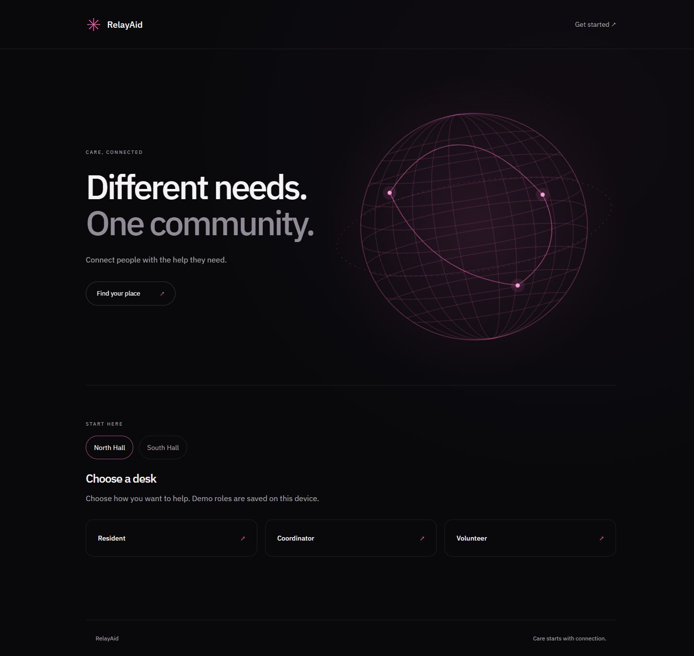
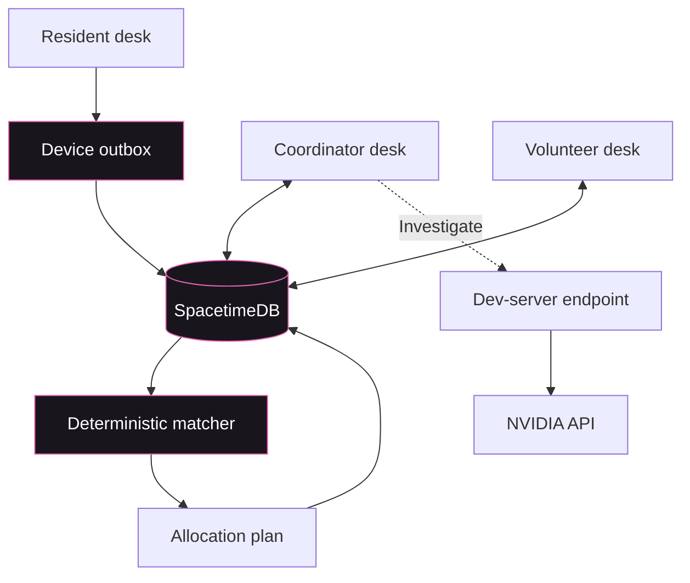
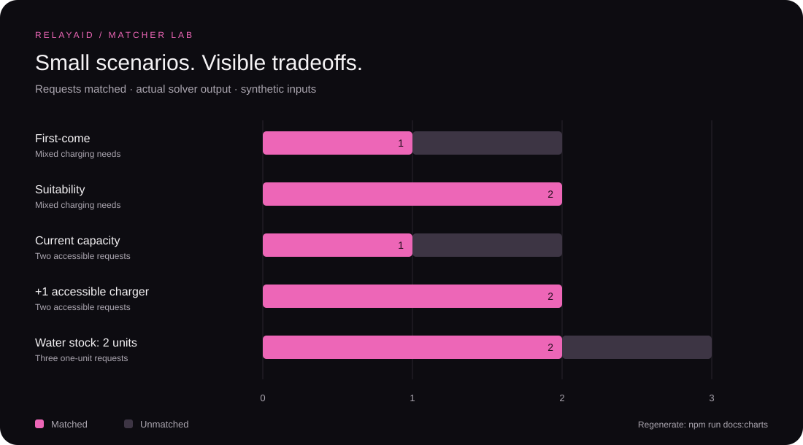
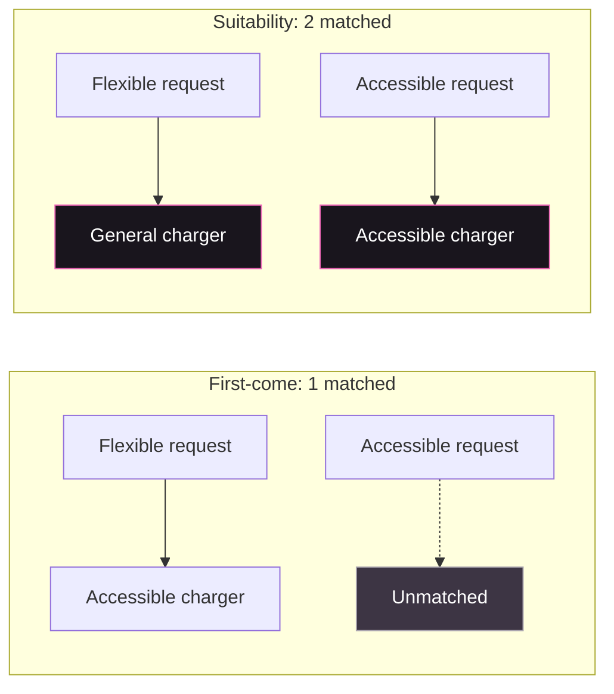
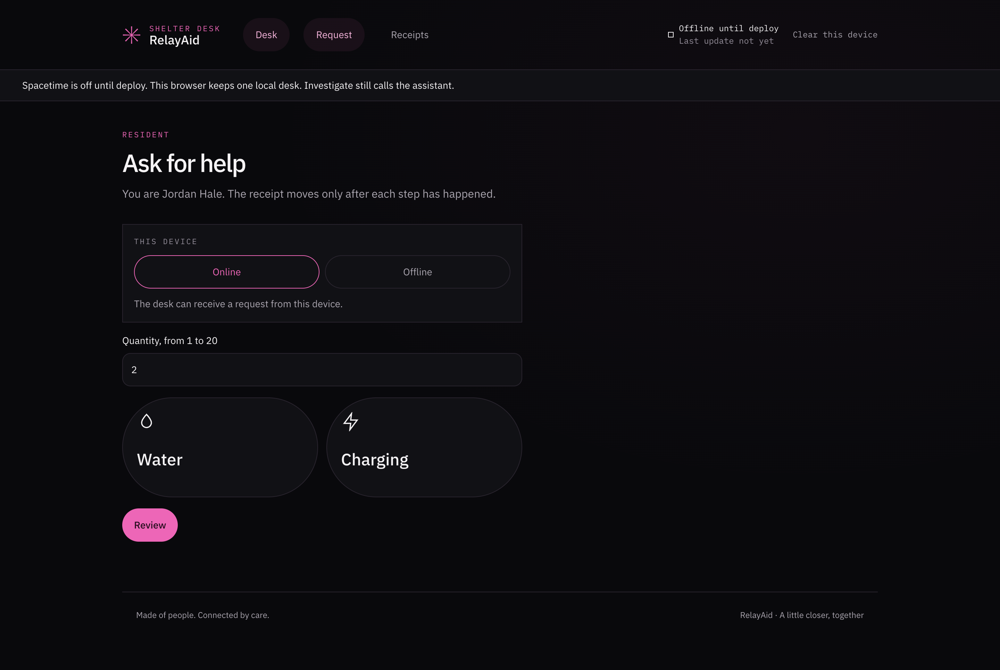
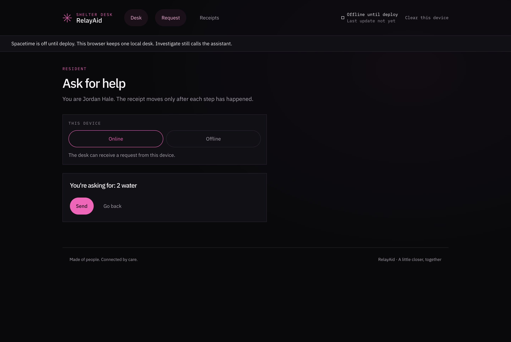
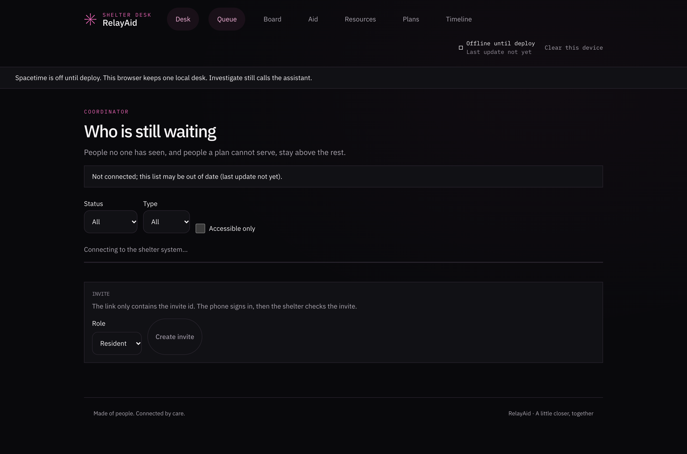
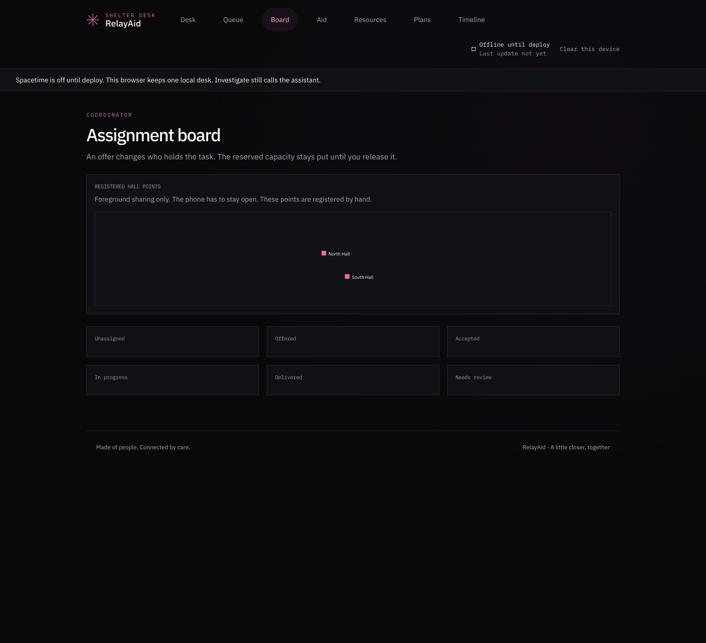
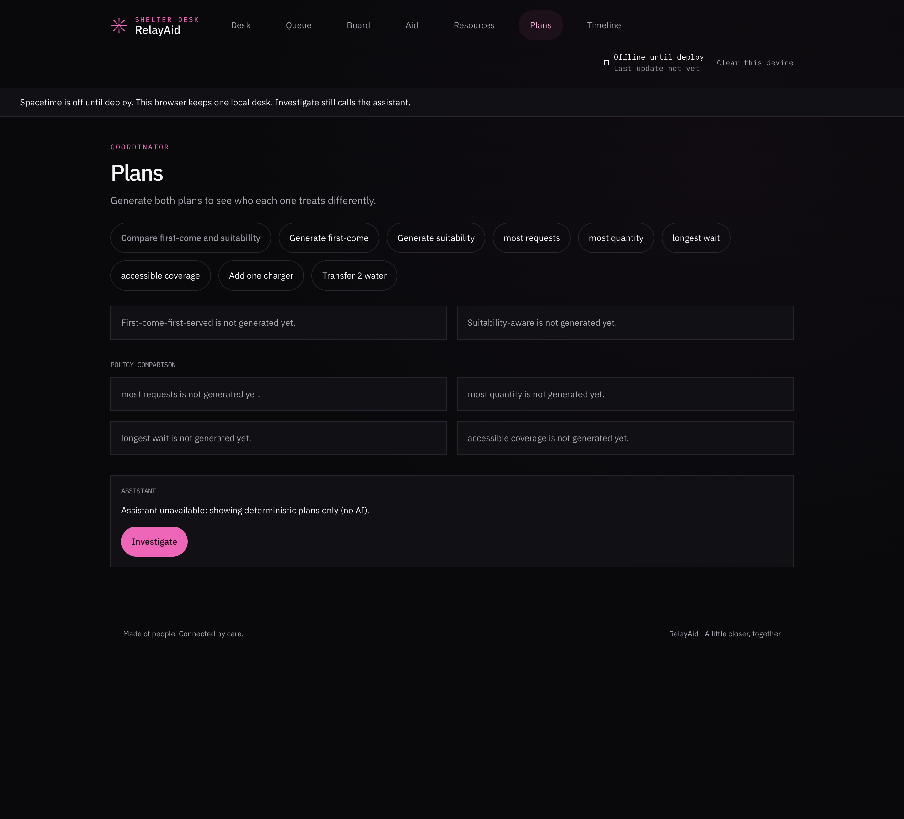

<div align="center">

# RelayAid

### Different needs. One community.

A shelter desk that connects people with water, charging, and the people who can help.

**React · TypeScript · SpacetimeDB**

[Quick start](#quick-start) · [How it works](#how-it-works) · [Matcher lab](#matcher-lab) · [Development](#development)

</div>



## One shelter. Three desks.

| Desk | Purpose | Entry point |
| :--- | :--- | :--- |
| **Resident** | Request water or charging and follow the receipt. | `/r/request` |
| **Coordinator** | Review requests, manage resources, compare plans, and assign help. | `/c/queue` |
| **Volunteer** | View assigned tasks and record delivery. | `/v/tasks` |

The homepage keeps the next step simple: choose a shelter, then a desk. A wireframe globe, subtle motion, and scroll reveals connect the experience visually. Reduced-motion preferences are respected.

The response desk is the path from the spec: **Call 911** stays on screen before sign-in. Continue as guest, then **Talk to RelayAid**. One confirmed sentence can open a water case and a linked rescue case. Water is reserved from hall stock, or transferred when a hall is short. Fire, medical, and rescue go to the fictional Synthetic Responder Sandbox, one status at a time, with no invented arrival time. The welcome screen also opens the synthetic responder console and the synthetic volunteer desk. Those desks are demo identities for the sandbox, not real dispatch.

> Screenshots show the local demo. Demo roles are stored on the device and are not real sign-in. Use another browser profile to try a second role.

## Quick start

Use a Node version supported by the installed SpacetimeDB SDK: `^22.23.4`, `^24.22.1`, or `>=26.12.1`.

```bash
npm ci
npm run dev
```

Open [localhost:5173](http://localhost:5173). Leave `VITE_SPACETIME_URI` unset for the local desk. Server-backed lists and planning need a running, configured SpacetimeDB module.

<details>
<summary><strong>Connect the shelter backend</strong></summary>

With the SpacetimeDB CLI installed and a local server running:

```bash
cd spacetimedb
npm ci
npm run publish:local
cd ..
```

Set `VITE_SPACETIME_URI` to your server endpoint in a local `.env` file, then restart Vite. `VITE_SPACETIME_DB_NAME` defaults to `relayaid-demo`.

For Investigate, copy the settings in [`.env.example`](.env.example) and configure `NEMOTRON_BASE_URL`, `NEMOTRON_API_KEY`, and `NEMOTRON_MODEL`. Keep the API key server-side; never prefix it with `VITE_` or commit it.

</details>

## How it works

A local save is not a confirmed delivery. The receipt advances only when the shelter system records the next step.


Unacknowledged requests stay unmatched and do not consume resource capacity.



The three desks share the same module. The outbox holds unsent requests; the matcher computes resource allocations. Investigate uses a separate server-side API path.

## Matcher lab

The chart below is **generated by executing the repository's solver**. These are deterministic examples, not live shelter statistics or performance benchmarks.



| Scenario | Matched | Unmatched | Method |
| :--- | ---: | ---: | :--- |
| Mixed charging needs · first-come | 1 | 1 | Heuristic |
| Same requests · suitability | 2 | 0 | Exact |
| Two accessible requests · current capacity | 1 | 1 | Exact |
| Same requests · one extra accessible charger | 2 | 0 | Exact |
| Three one-unit water requests · stock of 2 | 2 | 1 | Heuristic |

In the first pair, one request can use either charger and the other needs an accessible charger. Suitability reserves the accessible slot for the constrained request. In the second pair, a what-if adds capacity without modifying the original resource list.



Regenerate the SVG and its machine-readable data together:

```bash
npm run docs:charts
```

Source: [`scripts/generate-readme-charts.ts`](scripts/generate-readme-charts.ts) · Output: [`matcher-data.json`](docs/readme/matcher-data.json) · Logic: [`solver.ts`](spacetimedb/src/solver.ts)

<details>
<summary><strong>Solver boundaries and interpretation</strong></summary>

- First-come is labeled heuristic.
- Suitability uses exact search for up to 12 acknowledged requests, subject to its step budget. Larger inputs use a heuristic; budget exhaustion is labeled fallback.
- The longest-wait policy adds one weight per 30 minutes. This is a declared rule, not a claim of fairness. In the existing stock-of-5 fixture, the waiting household requesting 5 units is served before three newer one-unit requests.
- Shortage estimates remain unknown below five observations. The example values `1, 2, 2, 3, 4` produce a range of `1–4`; that range is not an arrival time.

</details>

## Inside the desk

These workflow screenshots show the earlier interface styling; the homepage image above reflects the current design.

| Request help | Review before sending |
| :---: | :---: |
|  |  |

<details>
<summary><strong>Coordinator views</strong></summary>





</details>

## Development

| Command | Purpose |
| :--- | :--- |
| `npm run dev` | Start the local Vite app |
| `npm run build` | Type-check and build the frontend |
| `npm run lint` | Run Oxlint |
| `npm run docs:charts` | Recompute README charts from solver fixtures |
| `cd spacetimedb && npm test` | Run Node tests plus module and access tests |

Run the focused matching checks from the repository root:

```bash
node --experimental-strip-types --test spacetimedb/src/solver.test.ts
```

| Location | Contents |
| :--- | :--- |
| `src/views/` | Resident, coordinator, and volunteer screens |
| `src/components/` | Shared UI and app shell |
| `spacetimedb/src/` | Module, access checks, matcher, and estimates |
| `client/` | Outbox code and tests |
| `worker/src/` | Worker guards and Investigate tests |
| `docs/readme/` | Screenshots, generated chart, and source data |

---

<div align="center">Care starts with connection.</div>
