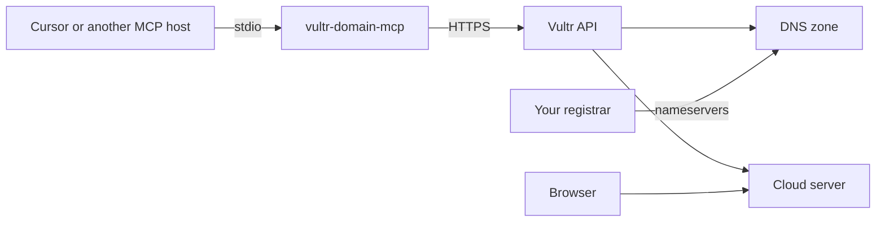

# Vultr domain hosting MCP server

This is an [MCP](https://modelcontextprotocol.io) server for hosting a domain on [Vultr](https://www.vultr.com/). It publishes a DNS zone and can create the cloud server that answers for that domain.

Vultr does not register or sell domain names. You buy the domain at a registrar, this server hosts the DNS (and optionally the machine), and you then point the registrar at Vultr's nameservers:

- `ns1.vultr.com`
- `ns2.vultr.com`



## Set up

You need Node.js 20 or newer and a Vultr API key from [the API settings page](https://my.vultr.com/settings/#settingsapi). The key needs the **DNS** permission. Creating a server also needs **provisioning**. Opening ports 22, 80, and 443 needs **firewall**.

```bash
npm install
npm test
npm run build
```

Copy `.env.example` to `.env` only if you run the server yourself. Do not commit the key.

### Cursor

Build first, then add the server with the project as its working directory. `examples/cursor-mcp.json` is the same config:

```json
{
  "mcpServers": {
    "vultr": {
      "command": "node",
      "args": ["dist/index.js"],
      "env": {
        "VULTR_API_KEY": "paste-your-key-here"
      }
    }
  }
}
```

If Cursor does not start the process in this directory, use the absolute path to `dist/index.js`.

Check the key with the `check-account` tool before asking it to create anything.

## Host a domain

Ask for one of these. A new server costs money, so the server will not create one until `acknowledge_billing` is true.

| Goal | Tool call |
| --- | --- |
| DNS only, you already have an address | `host-domain` with `domain` and `ip` |
| DNS for a server already on Vultr | `host-domain` with `domain` and `instance_id` |
| DNS plus a new server | `host-domain` with `domain`, `provision: true`, and `acknowledge_billing: true` |

`host-domain` then:

1. Creates the DNS zone if it does not exist.
2. Sets A records (and AAAA records when an IPv6 address is available) for the apex and `www`.
3. Leaves MX and other records alone. If an A record for that name already exists, it updates it.
4. When creating a server, chooses the cheapest Cloud Compute (`vc2`) plan in the region (default `ewr`, New Jersey), installs Ubuntu 24.04, and on first boot installs nginx with a placeholder page.
5. Opens SSH, HTTP, and HTTPS if the instance does not already have a firewall. An existing firewall is not replaced.
6. Returns the nameservers to set at your registrar.

Running it again for the same domain reuses the server tagged `vultr-domain-mcp` instead of buying a second one. It does not reinstall that server.

The placeholder page is HTTP only. After the domain resolves, install a certificate on the server. This server cannot do that for you, because the certificate request fails until the registrar is already pointing at Vultr.

Halted instances are still billed. `delete-instance` (with `confirm: true`) is what stops the charge. `delete-domain` removes only the DNS zone.

## Tools

| Tool | What it does |
| --- | --- |
| `check-account` | Shows whether the key can manage DNS, servers, and firewalls |
| `host-domain` | The hosting workflow above |
| `list-domains`, `get-domain`, `create-domain`, `delete-domain` | DNS zones |
| `list-records`, `create-record`, `update-record`, `delete-record` | Individual records |
| `get-dnssec`, `set-dnssec` | DNSSEC and the DS records to copy to the registrar |
| `list-regions`, `list-plans`, `list-operating-systems` | What you can deploy, including monthly prices |
| `list-instances`, `get-instance`, `create-instance`, `delete-instance` | Cloud servers |
| `start-instance`, `halt-instance`, `reboot-instance` | Power |
| `list-ssh-keys`, `create-ssh-key` | SSH public keys stored on the Vultr account |

There is also a `vultr://domain-hosting` resource and a `host-a-domain` prompt.

Record names are relative to the zone. `@` is the apex, and `www` means `www.example.com`, not a second zone.

## Development

```bash
npm test
npm run typecheck
npm run dev
```

`npm run dev` speaks MCP on stdin and stdout. Log lines go to stderr. `VULTR_API_BASE_URL` overrides the API host, which is `https://api.vultr.com/v2` by default.
